<div align="center">

<a href="https://mango3s.com"></a>

<a href="https://mango3s.com"></a>

*Say it fast: Mango Trees.* 🌳🥭

[](https://github.com/SamanFekri/Mango3S/releases/latest)
[](https://github.com/SamanFekri/Mango3S/releases)
[](LICENSE)
<br />
[](https://github.com/SamanFekri/Mango3S/releases/latest)
[](go.mod)
[](https://wails.io)
[](https://github.com/SamanFekri/Mango3S/commits/main)

<br />

[](https://github.com/SamanFekri/Mango3S/releases/latest)
[](https://github.com/SamanFekri/Mango3S/releases/latest)
[](https://github.com/SamanFekri/Mango3S/releases/latest)

**Free. No account. No license key. No trial that runs out.**

<br />

<picture>
  <source media="(prefers-color-scheme: dark)" srcset="https://mango3s.com/screenshots/collection-dark.webp" />
  
</picture>

</div>

## ✨ New in the latest version

- **📈 Live server monitor.** Operations per second, connections, cache, replica-set lag and the
  operations running right now, with a button to stop a runaway one.
- **📊 Charts from your data.** Turn any query or aggregation into a bar, line or pie chart.
- **🟨 A real JavaScript shell.** Variables, loops and functions against your database, or run your
  own `mongosh`.
- **🌲 Explain that finds the slow part.** The query plan as a tree, a side-by-side comparison, and
  a one-click index suggestion.
- **👀 Watch changes live**, **🗂️ browse GridFS files**, **🧪 generate test data**, and manage
  **sharded clusters**.

<div align="center">

</div>

See every version's changes on the [releases page](https://github.com/SamanFekri/Mango3S/releases).

## 🥭 Why Mango3S

- **Free, for real.** Everything is in the free app. There's nothing to unlock.
- **Fast and native.** A real desktop app for macOS, Windows and Linux, not a browser tab.
- **Safe by default.** Anything that changes data shows you a preview first and backs up what it
  touches. Your passwords stay in your system's keychain.
- **Everything in one place.** From a quick look at a document to migrating a whole SQL database.

## 🧰 What you can do

**🔌 Connect to anything.** Local servers, replica sets, sharded clusters and Atlas. SSH tunnels,
proxies, TLS certificates and every common way to sign in.

**🔍 Explore your data.** Browse documents as a tree, a table or JSON. Double-click any value to
edit it in place.

**⚡ Query your way.** Use mongosh syntax with autocomplete, build queries visually, or just write
SQL and let Mango3S translate it.

<picture>
  <source media="(prefers-color-scheme: dark)" srcset="https://mango3s.com/screenshots/aggregation-dark.webp" />
  
</picture>

**🧱 Build aggregations stage by stage.** Preview the output of every stage as you go.

**🧬 Understand your schema.** See every field, its types and how often it shows up, then get
index suggestions for your slow queries.

**💻 Turn queries into code.** Copy any query or pipeline as ready-to-run Node.js, Python, Java,
C#, Go or mongosh.

<details>
<summary><b>And a lot more…</b></summary>
<br />

<picture>
  <source media="(prefers-color-scheme: dark)" srcset="https://mango3s.com/screenshots/schema-dark.webp" />
  
</picture>

**📦 Move data around.** Import and export JSON and CSV, back up and restore databases, compare
and sync collections, and migrate from PostgreSQL, MySQL or SQLite.

**🛡️ Work with care.** Mask sensitive data for test environments, schedule recurring jobs, and
roll back changes from automatic backups.

**✨ Ask AI (optional).** Describe what you want in plain words and get a query back. It's off by
default and only ever sees field names, never your data or credentials.

**🔄 Sync across computers (optional).** Bring your connections to every machine, end-to-end
encrypted. Nothing in the app needs an account.

**🧹 Keep your disk tidy.** Settings › Storage shows what Mango3S keeps on your computer and clears
caches and logs in one click.

The full list is in **[docs/FEATURES.md](docs/FEATURES.md)**.

</details>

And yes, there's Mango 🥭, a small mascot who cheers you on. You can hide it in Settings.

##  Get Mango3S

Download the latest version from **[GitHub Releases](https://github.com/SamanFekri/Mango3S/releases/latest)**
or **[mango3s.com](https://mango3s.com)**, which detects your system and picks the right file.

| System | Download | Install |
|---|---|---|
| **macOS**, Apple Silicon (M1 and later) | `…-macos-arm64.dmg` | Open it and drag **Mango3S** into **Applications**. |
| **macOS**, Intel | `…-macos-amd64.dmg` | Same. |
| **Windows** 64-bit | `…-windows-amd64-setup.exe` | Run the installer. Or use the portable `.exe`. |
| **Windows** 32-bit | `…-windows-386.exe` | Portable: just run it. |
| **Linux** (Debian, Ubuntu) | `…-linux-amd64.deb` | `sudo apt install ./mango3s-*.deb` |
| **Linux** (other) | `…-linux-amd64.tar.gz` | Extract and run `mango3s`. Needs WebKitGTK (`libwebkit2gtk-4.1-0`). |

<details>
<summary><b>"Can't be opened" or "Windows protected your PC"?</b></summary>
<br />

Mango3S isn't code-signed yet, so your system asks once:

- **macOS:** right-click Mango3S › **Open** › **Open**. Or open **System Settings › Privacy &
  Security** and click **Open Anyway**.
- **Windows:** in the SmartScreen dialog, click **More info › Run anyway**.

Every download has a `.sha256` checksum if you want to verify it.

</details>

Mango3S updates itself: it checks for new versions, verifies the download and asks before
installing.

**Try it in a minute:** click **New connection**, enter `mongodb://localhost:27017` (or your
Atlas connection string), then **Save & connect**.

## 🤝 Contribute

Mango3S is open source, and contributions are very welcome: bug reports, ideas, docs and code.

- **🐛 Found a bug or have an idea?** [Open an issue](https://github.com/SamanFekri/Mango3S/issues).
- **⭐ Like it?** [Star the repo](https://github.com/SamanFekri/Mango3S): it really helps other
  people find it.
- **🧑‍💻 Want to write code?** Here's how to run it locally:

```bash
git clone https://github.com/SamanFekri/Mango3S.git && cd Mango3S
make mongo-up   # optional: a local MongoDB with sample data (needs Docker)
make dev        # the app with hot reload
make test       # run before opening a pull request
```

You'll need Go 1.25+, Node.js 20+ and the [Wails CLI](https://wails.io) (`wails doctor` checks
your setup). Keep pull requests focused, add tests for new behavior, and describe what changed and
why.

The full feature list, build options, architecture and troubleshooting live in
**[docs/REFERENCE.md](docs/REFERENCE.md)**. Releases are explained in
**[docs/RELEASING.md](docs/RELEASING.md)**.

## 👋 Made by

<a href="https://github.com/SamanFekri"></a>

Mango3S is built by **[@SamanFekri](https://github.com/SamanFekri)**. Say hi, share what you
built with it, or tell me what to add next.<br />
[](https://github.com/SamanFekri)
[](https://samanfekri.me)

<br clear="left" />

## ⭐ Star history

<a href="https://star-history.com/#SamanFekri/Mango3S&Date">
  <picture>
    <source media="(prefers-color-scheme: dark)" srcset="https://api.star-history.com/svg?repos=SamanFekri/Mango3S&type=Date&theme=dark" />
    
  </picture>
</a>

## 📄 License

Mango3S is free software under the [GNU GPL v3](LICENSE). Copyright © 2026 Saman Fekri.

<div align="center">
<br />
<a href="https://mango3s.com"><b>mango3s.com</b></a> · made with 🥭 by <a href="https://github.com/SamanFekri">@SamanFekri</a>
</div>
